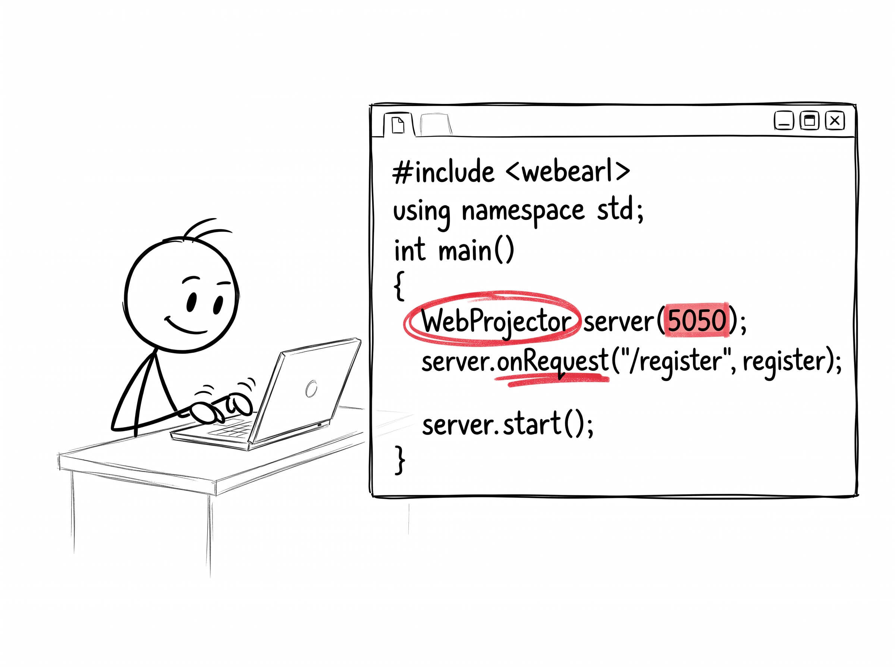
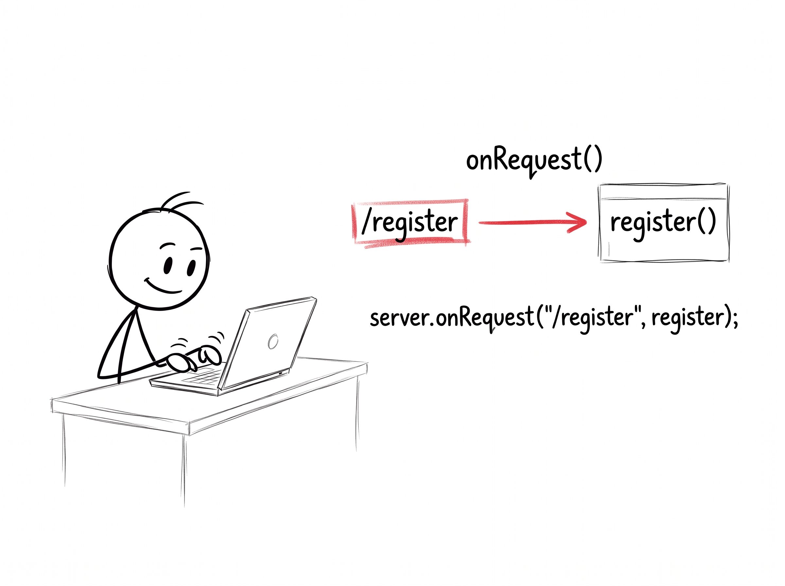
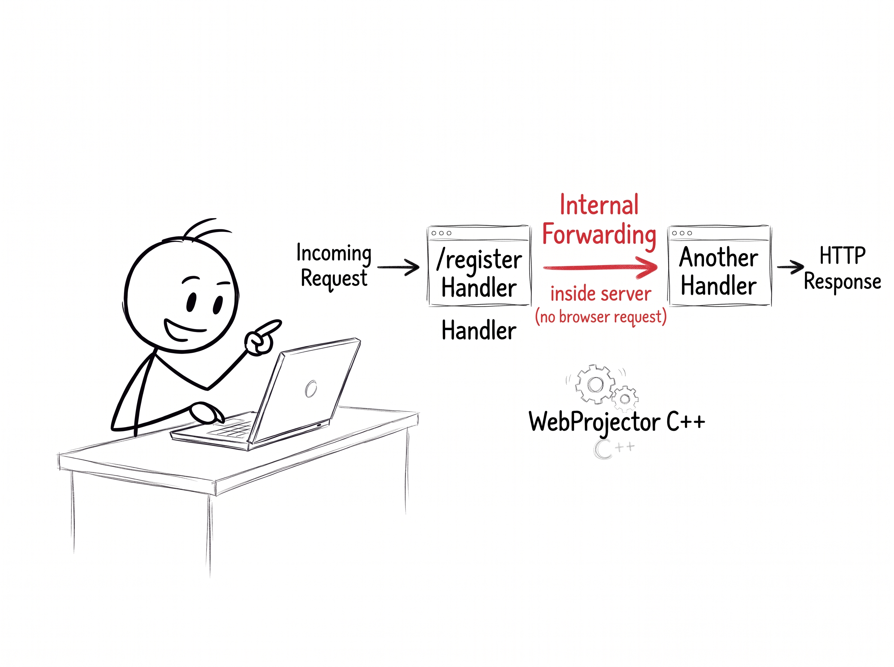
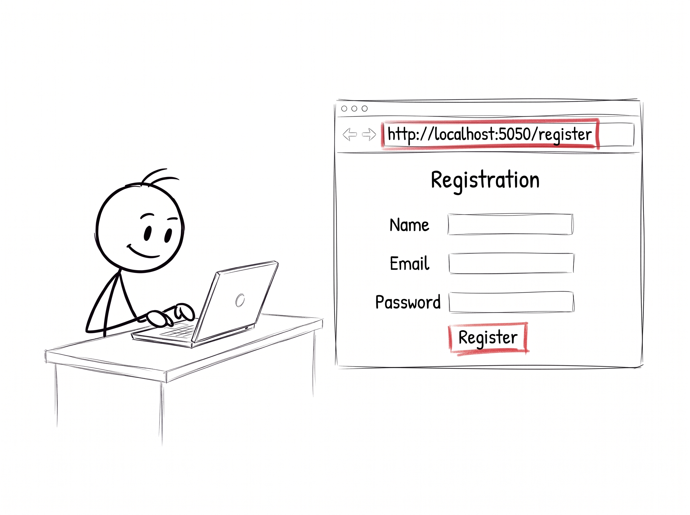
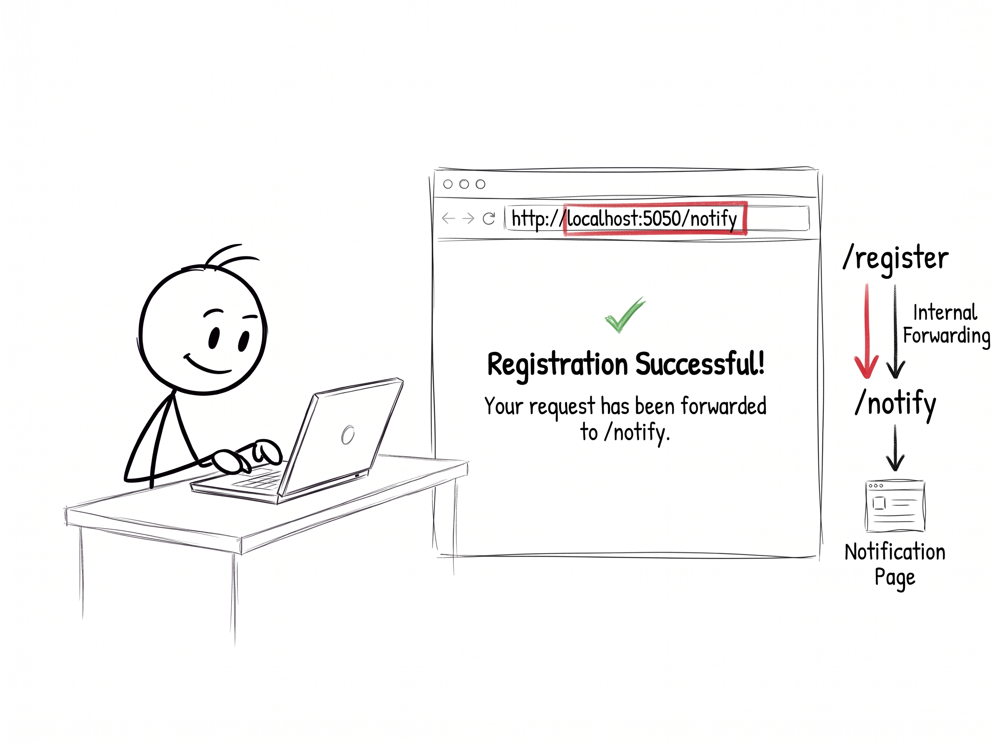

# `WebProjector`

`A C++ HTTP Web Server Built From Scratch Using Socket Programming`

`A lightweight HTTP web server that handles client requests, maps URLs to custom handlers, serves static resources, and supports internal request forwarding.`


---

## `ABOUT`

`WebProjector is a C++ HTTP web server developed from scratch using socket programming. The primary objective of this project was to understand how web servers communicate with clients, process incoming HTTP requests, and generate appropriate responses without relying on existing web server frameworks.`

`The server establishes TCP socket connections with clients and processes HTTP requests received through those connections. It parses request information, identifies URL paths, extracts GET query parameters, and maps requested URLs to their corresponding custom handler functions.`

`WebProjector also supports serving static resources such as HTML, CSS, JavaScript, and images. It includes an internal request forwarding mechanism that allows one request handler to transfer processing to another registered handler within the same server.`

`The project focuses on implementing the fundamental mechanisms behind HTTP communication, URL routing, request processing, and response generation, providing a practical understanding of how web servers operate internally.`

---

## `PROJECT DEMONSTRATION`

`A short demonstration of WebProjector, showcasing server initialization, request mapping, browser communication, and internal request forwarding.`

https://github.com/user-attachments/assets/3d8d909c-6b09-45aa-bfa1-7e489c0836aa

---

## `HOW IT WORKS`

`The following illustrations demonstrate how WebProjector is initialized, how URL paths are mapped to handler functions, and how requests are processed and forwarded internally.`

<table>
<tr>
<td width="50%">

<p align="center"><code>1. Initializing the WebProjector server and registering a request handler.</code></p>
</td>
<td width="50%">

<p align="center"><code>2. Mapping the /register URL to its corresponding register() handler using onRequest().</code></p>
</td>
</tr>
<tr>
<td width="50%">

<p align="center"><code>3. Understanding internal request forwarding between registered handlers.</code></p>
</td>
<td width="50%">

<p align="center"><code>4. Accessing the registration page through http://localhost:5050/register.</code></p>
</td>
</tr>
</table>

<p align="center">

</p>

<p align="center">
<code>5. The registration request is forwarded internally to /notify, which generates the final notification page.</code>
</p>

---

## `FEATURES`

- `TCP socket creation and connection handling using Winsock.`
- `HTTP request reception and parsing.`
- `Extraction of HTTP request methods and URL paths.`
- `GET query parameter extraction.`
- `URL routing through the requestMappings map.`
- `Custom request handling through the onRequest() function.`
- `Internal request forwarding between registered handlers.`
- `Static resource serving for HTML, CSS, JavaScript, and image files.`
- `MIME type identification based on resource extensions.`
- `HTTP response generation and transmission.`
- `Support for chunked transfer encoding.`

---

## `TECHNOLOGIES USED`


- `C++ — Core server implementation and request processing.`
- `Winsock — Windows socket API used for TCP communication.`
- `TCP/IP — Network communication between the server and clients.`
- `HTTP — Application-layer protocol used for client-server communication.`

---

## `LIMITATIONS`

- `HTTPS and TLS encryption are not currently implemented.`
- `Support for HTTP methods and protocol features is limited to the implemented functionality.`
- `Advanced features such as sessions, cookies, and built-in authentication are not provided.`
- `The server has limited concurrency and scalability compared with production-grade web servers.`
- `Security mechanisms against common web attacks require further implementation.`
- `The current socket implementation is platform-dependent due to its use of Winsock.`

---

## `PROJECT STRUCTURE`

```text
WebProjector/
├── include/
│   └── webearl/
├── src/
├── examples/
├── images/
│   ├── one.png
│   ├── two.png
│   ├── three.png
│   ├── four.png
│   └── five.png
└── README.md
```

`The directory structure above is illustrative. Actual directory names should match the repository.`

---

## `PROJECT OBJECTIVE`

`WebProjector was developed as a learning-oriented project to explore the internal working of HTTP web servers and the networking concepts behind web application communication.`

`Building the server from scratch provided an opportunity to work with TCP sockets, HTTP request parsing, URL routing, resource handling, and response generation while understanding how these components work together to serve client requests.`
